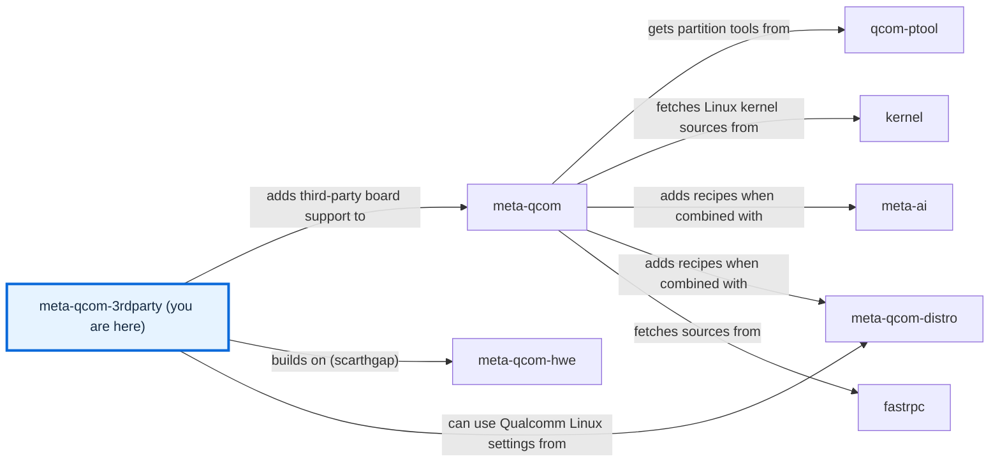

# meta-qcom-3rdparty

[)](https://github.com/qualcomm-linux/meta-qcom-3rdparty/actions/workflows/push.yml)
[)](https://github.com/qualcomm-linux/meta-qcom-3rdparty/actions/workflows/nightly-build.yml)

[)](https://github.com/qualcomm-linux/meta-qcom-3rdparty/actions/workflows/push.yml?query=branch%3Awrynose)
[)](https://github.com/qualcomm-linux/meta-qcom-3rdparty/actions/workflows/nightly-build.yml?query=branch%3Awrynose)

## Introduction

OpenEmbedded/Yocto Project BSP layer for Third-Party Maintained Qualcomm based
platforms.

This layer provides additional recipes and machine configuration files for
Third-Party Maintained Qualcomm platforms. Reference boards that are officially
supported by Qualcomm are available via [`meta-qcom`](https://github.com/qualcomm-linux/meta-qcom) instead.

This layer depends on:

```text
URI: https://github.com/openembedded/openembedded-core.git
layers: meta
branch: master
revision: HEAD

URI: https://github.com/qualcomm-linux/meta-qcom.git
branch: master
revision: HEAD
```

To build an image for a supported board, follow the
[usage tutorial](docs/source/user/USAGE.md).

## Branches

| Branch | Purpose | Status | Build from it | Contributions | Relationship to `main` |
| --- | --- | --- | --- | --- | --- |
| [`main`](https://github.com/qualcomm-linux/meta-qcom-3rdparty/tree/main) | Primary development branch, with focus on upstream support and compatibility with the most recent Yocto Project release. | Compatible with Yocto Project 6.1 (Blacksail), as [`conf/layer.conf`](conf/layer.conf) declares; [SECURITY.md](SECURITY.md) accepts patches for it. | Yes: see [Machine Support](#machine-support). | Changes for the upstream baseline, as section 3 of the [contribution guide](docs/source/contributing/CONTRIBUTING.md#3--upstream-baseline) describes; fixes land here first and are then backported. | Default branch. |
| [`wrynose`](https://github.com/qualcomm-linux/meta-qcom-3rdparty/tree/wrynose) | LTS branch based on the Yocto Project 6.0 release, used by Qualcomm Linux 2.x. | Long Term Support; Yocto Project 6.0 is supported until April 2030 ([Yocto Project releases](https://wiki.yoctoproject.org/wiki/Releases)). | Yes: it holds the same [machine configurations](https://github.com/qualcomm-linux/meta-qcom-3rdparty/tree/wrynose/conf/machine). | Backports of changes merged on `main`, opened automatically for pull requests labelled `backport wrynose`; changes that apply only to `wrynose` ([backporting guide on `wrynose`](https://github.com/qualcomm-linux/meta-qcom-3rdparty/blob/wrynose/BACKPORTING.md)). | Maintained separately: receives cherry-picked changes from `main` and does not merge back. |
| [`scarthgap`](https://github.com/qualcomm-linux/meta-qcom-3rdparty/tree/scarthgap) | Qualcomm Linux >= 1.4, aligned with Yocto Project 5.0 (LTS). | Yocto Project 5.0 is supported until April 2028 ([Yocto Project releases](https://wiki.yoctoproject.org/wiki/Releases)); last commit on [2025-09-03](https://github.com/qualcomm-linux/meta-qcom-3rdparty/commit/b411da79d08b3726eeba85df834627008b31fd7c). | No: it holds only [`conf/layer.conf`](https://github.com/qualcomm-linux/meta-qcom-3rdparty/tree/scarthgap/conf) and policy files, with no machine configurations. | Contributions for Qualcomm Linux 1.x, as section 4 of the [contribution guide](docs/source/contributing/CONTRIBUTING.md#4--downstream-baseline--qualcomm-linux-1x) describes. | Not documented. |
| [`kirkstone`](https://github.com/qualcomm-linux/meta-qcom-3rdparty/tree/kirkstone) | Qualcomm Linux <= 1.3, aligned with Yocto Project 4.0 (LTS). | Yocto Project 4.0 has reached end of life ([Yocto Project releases](https://wiki.yoctoproject.org/wiki/Releases)); last commit on [2025-04-09](https://github.com/qualcomm-linux/meta-qcom-3rdparty/commit/d2f48af6ee98870294be24c16673dde7fa941543). | No: it holds only [`conf/layer.conf`](https://github.com/qualcomm-linux/meta-qcom-3rdparty/tree/kirkstone/conf) and policy files, with no machine configurations. | Not documented; [SECURITY.md](SECURITY.md) accepts patches only for the LTS releases and `main`. | Not documented. |
| [`next`](https://github.com/qualcomm-linux/meta-qcom-3rdparty/tree/next) | Not documented. | Last commit on [2026-08-20](https://github.com/qualcomm-linux/meta-qcom-3rdparty/commit/9d6a08df6bf47047d359794155f315fae5c6b96d). | Not documented; it holds [machine configurations](https://github.com/qualcomm-linux/meta-qcom-3rdparty/tree/next/conf/machine) for `uno-q`, `ventuno-q`, and `radxa-dragon-q6a`. | Not documented. | Not documented. |

## Machine Support

See [`conf/machine`](conf/machine/README.md) for the complete list of supported devices.

## Documentation

The [documentation guide](docs/README.md) indexes the
[usage tutorial](docs/source/user/USAGE.md), the
[configuration reference](docs/source/user/CONFIGURATION.md), the
[development setup](docs/source/contributing/DEVELOPMENT.md), and the
[function reference](docs/source/contributing/README.md#function-reference).
Build the documentation site from the repository root, after installing the
[prerequisites](docs/source/contributing/DEVELOPMENT.md#prerequisites), then open
`docs/site/index.html` directly in a browser:

```sh
make -f docs/source/Makefile setup html
```

## Contributing

Please read the [contribution guide](docs/source/contributing/CONTRIBUTING.md),
which explains how to submit patches, the contribution
workflow, the layer scope rules and the commit subject and message
requirements, before opening a pull request. Follow the
[Code of Conduct](CODE_OF_CONDUCT.md) when participating.

## Communication

- **GitHub Issues:** [meta-qcom-3rdparty issues](https://github.com/qualcomm-linux/meta-qcom-3rdparty/issues)
- **Pull Requests:** [meta-qcom-3rdparty pull requests](https://github.com/qualcomm-linux/meta-qcom-3rdparty/pulls)

## Maintainer(s)

- Ricardo Salveti <ricardo.salveti@oss.qualcomm.com>
- Nicolas Dechesne <nicolas.dechesne@oss.qualcomm.com>

## License

This layer is licensed under the MIT license. Check out [LICENSE](LICENSE)
for more details. [NOTICE](NOTICE) holds the licences of the documentation tools
and templates adapted from other projects.

## Folders

- [.github/](.github/) — Holds the CI [workflows](.github/workflows/), [CODEOWNERS](.github/CODEOWNERS), the [issue templates](.github/ISSUE_TEMPLATE/), the [pull request template](.github/PULL_REQUEST_TEMPLATE/pr_template.md), the Markdown lint rules, and the documentation build scripts.
- [ci/](ci/README.md) — Holds the [kas](https://github.com/siemens/kas) fragments and scripts that CI builds and checks the layer with.
- [conf/](conf/README.md) — Registers the layer and defines its machines.
- [docs/](docs/README.md) — Holds the documentation source and explains how to build the site.
- [dynamic-layers/](dynamic-layers/README.md) — Holds appends that apply only when another layer is in the build.
- [recipes-bsp/](recipes-bsp/README.md) — Holds the boards' firmware recipes and package groups.
- [recipes-kernel/](recipes-kernel/README.md) — Holds the kernel appends and configuration fragments.

## Files

- [.env.example](.env.example) — Documents the environment settings for kas builds and the command that loads them.
- [.gitignore](.gitignore) — Keeps local environment files and the generated documentation out of Git.
- [AGENTS.md](AGENTS.md) — Points automation agents to the agent guide.
- [CLAUDE.md](CLAUDE.md) — Links to `AGENTS.md` for agents that read this name.
- [CODE_OF_CONDUCT.md](CODE_OF_CONDUCT.md) — States the expected behaviour and how to report conduct concerns.
- [CONTRIBUTING.md](CONTRIBUTING.md) — Points contributors to the contribution guide and development setup.
- [LICENSE](LICENSE) — Contains the layer's MIT licence.
- [NOTICE](NOTICE) — Contains the licences of material adapted from other projects.
- [README.md](README.md) — Introduces the layer, its branches, and its contents.
- [SECURITY.md](SECURITY.md) — Explains how to report vulnerabilities and which branches receive security fixes.

<!-- repository-map:start -->

## Repository map



[Full Qualcomm repository map](https://github.com/devdocsorg/qualcomm-repository-map).

<!-- Generated from https://github.com/devdocsorg/qualcomm-repository-map at 2d4a2fb5ee1e6d6e75f85c3ba1352b80a173b7eb; dataset SHA-256: 8e92870c8f246f499f7a96cd90969886d317f45fb8a76c553db35e306a044275. -->

<!-- repository-map:end -->
